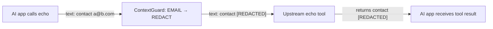
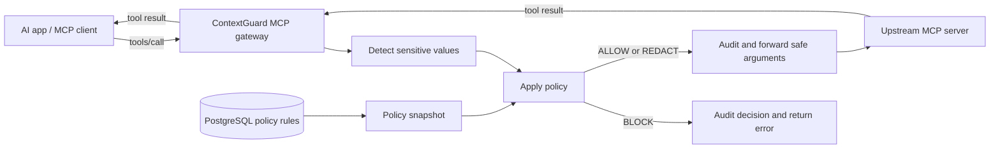

# ContextGuard

**ContextGuard helps control what an AI app sends to a selected MCP tool server.**

## Overview

An AI app can call tools that send data to services outside an organization's intended boundary. A search query, ticket, or other tool argument could contain a customer's email address or a credential. ContextGuard sits between the MCP caller and a selected upstream tool server, where it can check those outgoing arguments before the server receives them.

The gateway detects selected sensitive values, applies PostgreSQL-backed rules to allow, redact, or block the call, and records decision metadata without storing the original arguments in its audit table. It demonstrates a policy boundary that an organization could adapt to its own tools, data, and handling rules. The included rules are examples: an email may belong in an approved internal spreadsheet but should not necessarily be sent to an external search tool. Today, ContextGuard protects **tool-call arguments sent to one configured upstream**; tool-specific decisions are a [next step](#current-scope-and-next-steps).

## Demo

The repository includes a separate MCP server with `echo` and `uppercase` tools. The [verification script](scripts/verify-gateway.ps1) connects to ContextGuard as an MCP client and calls both tools.

Here is the email-redaction scenario. The verification script stands in for an AI app: ContextGuard receives the **tool-call argument**, applies the email rule, and sends only the redacted value to the upstream tool.



The AI app's full prompt does not necessarily pass through ContextGuard; this gateway inspects the arguments sent in MCP `tools/call` requests.

```text
PASS: gateway lists echo and uppercase
PASS: plain echo reaches upstream
PASS: email is redacted before echo
PASS: second tool uses the same guard
PASS: payment card is redacted
PASS: token is blocked
```

The email and card examples use synthetic values. The token example produces an MCP tool error without calling the upstream tool. After [starting the services](#getting-started), run the script yourself and inspect the audit records:

```powershell
.\scripts\verify-gateway.ps1 -GatewayUrl http://127.0.0.1:18080/mcp
```

```cmd
docker compose exec postgres psql -U contextguard -d contextguard -c "SELECT tool_name, outcome, detection_count, snapshot_version FROM policy_audit_events ORDER BY id DESC LIMIT 6;"
```

The audit rows contain decision metadata, not the email, payment-card number, token, or full tool arguments.

## Capabilities

- Discovers the tools and schemas of one configured Streamable HTTP MCP upstream when ContextGuard starts, then exposes those tools through guarded handlers.
- Checks strings and nested tool arguments for email addresses, Philippine mobile numbers, payment-card candidates, authentication tokens, and sensitive JSON fields.
- Applies database rules with `BLOCK` taking priority over `REDACT`, then `ALLOW`. A detected type without an enabled rule is blocked.
- Builds a separate sanitized argument structure for redacted calls, preserving the caller's original arguments.
- Writes an audit record before forwarding. If the decision cannot be processed or audited safely, the call is not forwarded.

The included migrations seed **example policy rules**, not a universal policy:

| Detection | Example decision |
| --- | --- |
| Email address | `REDACT` |
| Philippine mobile number | `REDACT` |
| Payment-card candidate | `REDACT` |
| Authentication token | `BLOCK` |
| Sensitive JSON field | `BLOCK` |

## How it works



ContextGuard is one Spring Boot gateway organized into focused packages for MCP integration, detection, policy evaluation, redaction, and persistence. The demo upstream is a separate application. Spring AI handles the MCP client and server connections; a ContextGuard-owned service controls each `tools/call` before the upstream client can invoke it. Flyway creates the database schema, JPA loads the rules, and the application evaluates calls against an immutable in-memory policy snapshot. An explicit refresh service can replace that snapshot, but there is currently no administration endpoint for it.

## Tech Stack

| Technology | Role |
| --- | --- |
| Java 21 | Application language |
| Spring Boot 4.1.1 and Spring WebMVC | Application runtime and HTTP server |
| Spring AI 2.0.1 and MCP Streamable HTTP | MCP server and client integration |
| PostgreSQL 17 | Policy rules and audit metadata |
| Spring Data JPA | Database entities and repositories |
| Flyway | Versioned schema and example-rule migrations |
| Docker Compose | Local PostgreSQL setup |
| Maven Wrapper and JUnit | Reproducible builds and automated tests |

## Testing

| Check | Evidence |
| --- | --- |
| Detection and policy decisions | Unit tests cover detectors, precedence, missing rules, and snapshots. |
| Redaction | Unit tests cover nested arguments, overlapping text ranges, and preservation of original input. |
| Database wiring | Application tests load seeded rules and verify metadata-only audit persistence. |
| Real MCP calls | `scripts/verify-gateway.ps1` checks tool discovery, ordinary forwarding, redaction through two tools, and blocking. |

With PostgreSQL running and `SPRING_DATASOURCE_PASSWORD` set in the same Command Prompt terminal, run the gateway tests from the repository root:

```cmd
mvnw.cmd test
```

The demo upstream has its own test suite:

```cmd
cd demoupstream
mvnw.cmd test
```

## What I learned

### MCP and integration

- **MCP client and server roles:** An application can expose tools to a caller while acting as a client to another MCP server. ContextGuard uses both roles to sit between them.
- **Tool discovery and calls:** I worked with initialization, `tools/list`, and `tools/call`, and learned why the gateway needs its own guarded handlers instead of automatically re-exposing upstream tools.

### Privacy logic

- **Detection, decision, and action are separate steps:** Finding sensitive data does not decide the response by itself. Policy selects `ALLOW`, `REDACT`, or `BLOCK`, with blocking taking priority.
- **Safe redaction and checksums:** The Luhn checksum helps reduce false payment-card matches; it does not prove that a card exists. I also learned to merge overlapping text ranges and replace from right to left so earlier character positions remain valid.

### Database and operations

- **Flyway and JPA have different jobs:** Flyway versions schema and example-rule changes. JPA maps the resulting tables to entities and repositories for application access.
- **Repeatable local setup:** Docker Compose starts PostgreSQL with a known configuration. Audit records capture decisions without keeping the sensitive argument values.

### Engineering workflow

- **Testing at different levels:** Unit tests check detectors and policy behavior, application tests check Spring and database wiring, and the verification script exercises real MCP calls through the gateway.
- **Recording decisions and changes:** Architecture decision records explain choices such as explicit tool forwarding and immutable snapshots. Focused commits make each change easier to review.

## Current scope and next steps

ContextGuard currently uses one configured upstream, discovers tools at startup, and checks tool-call arguments. Rules are selected by detection type, not by tool or destination, so the example email rule applies to every tool exposed through that gateway. It does not inspect upstream responses. The local demo binds to loopback addresses and does not provide gateway authentication, TLS termination, or an operator interface for policy changes. Treat it as a working prototype rather than a production security boundary.

| Next step | Why it matters |
| --- | --- |
| Tool- and destination-specific policy | Allows an approved internal tool to receive data that should be redacted or blocked for an external service. |
| Authentication and transport security | Required before exposing the gateway beyond a trusted local environment. |
| Automated tests that start a real upstream | Makes the end-to-end path repeatable in CI. |
| Policy administration and controlled refresh | Lets operators change rules without manual database edits or a restart. |
| Broader upstream support and catalog refresh | Allows more integrations and tool-list changes while the gateway is running. |
| Response inspection | Extends protection to sensitive data returned by upstream tools. |

## Getting started

These steps use Windows Command Prompt for the applications and Windows PowerShell for the verification script. You need Java 21 and Docker Desktop. Run commands from the repository root unless a step says otherwise. The Maven wrappers are included; a system-wide Maven installation is not required.

1. Create a `.env` file in the repository root with a unique local database password:

   ```dotenv
   POSTGRES_PASSWORD=replace-with-a-strong-local-password
   ```

   `.env` is ignored by Git. Use the same password for `SPRING_DATASOURCE_PASSWORD` below. Docker Compose reads `.env`; it does not automatically pass that password to the Java application. If you already initialized the PostgreSQL volume, keep using its original password unless you intentionally change the database user's password.

2. Start PostgreSQL and wait for `healthy` in `docker compose ps`:

   ```cmd
   docker compose up -d postgres
   docker compose ps
   ```

3. In a second Command Prompt terminal, start the demo upstream on port `18081`:

   ```cmd
   cd demoupstream
   mvnw.cmd spring-boot:run -Dspring-boot.run.arguments=--server.port=18081
   ```

   Wait for `Tomcat started on port 18081`. Keep this terminal open.

4. In a third Command Prompt terminal at the repository root, start ContextGuard on port `18080`:

   ```cmd
   set "SPRING_DATASOURCE_PASSWORD=your-local-database-password"
   set "CONTEXTGUARD_UPSTREAM_URL=http://127.0.0.1:18081"
   mvnw.cmd spring-boot:run -Dspring-boot.run.arguments=--server.port=18080
   ```

   Wait for `Tomcat started on port 18080`. ContextGuard discovers upstream tools during startup, so start the upstream first. Flyway applies pending migrations as ContextGuard connects to PostgreSQL.

5. In Windows PowerShell, change to the repository root and run the command in [Demo](#demo). Expect six `PASS` lines. If script execution is blocked by PowerShell's execution policy, `Set-ExecutionPolicy -Scope Process Bypass` changes the setting only for that PowerShell session.

To use another Streamable HTTP MCP server, set `CONTEXTGUARD_UPSTREAM_URL` to its base URL before starting ContextGuard. The endpoint path defaults to `/mcp` and can be changed with `CONTEXTGUARD_UPSTREAM_ENDPOINT`. Restart ContextGuard when the upstream's tool list changes. The configured upstream must be reachable when ContextGuard starts.

## Architecture decisions

- [ADR 0001: Technology baseline](docs/adr/0001-technology-baseline.md)
- [ADR 0002: Controlled MCP tool forwarding](docs/adr/0002-controlled-mcp-tool-forwarding.md)
- [ADR 0003: Policy evaluation and safe redaction](docs/adr/0003-policy-evaluation-and-redaction.md)
