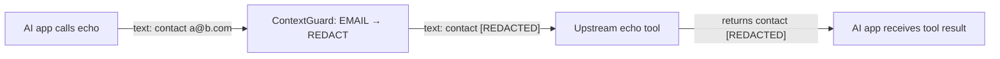
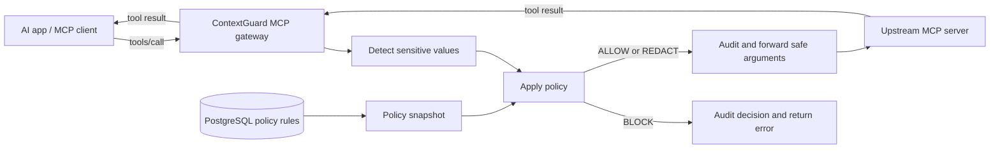

# ContextGuard

**Policy-driven data loss prevention for AI agents' MCP tool calls.** ContextGuard checks outgoing tool arguments before they reach a connected tool server, then allows, redacts, or blocks them according to policy.

    [](https://github.com/angelfrancel/contextguard/actions/workflows/ci.yml)

```text
PASS: email is redacted before echo
PASS: approved internal tool receives the email
PASS: token is blocked
```

## Overview

An AI app can call tools that send data to services outside an organization's intended boundary. A search query, ticket, or other tool argument could contain a customer's email address or a credential. ContextGuard sits between the MCP caller and a selected upstream tool server, where it can check those outgoing arguments before the server receives them.

The gateway detects selected sensitive values, applies PostgreSQL-backed rules to allow, redact, or block the call, and records decision metadata without storing the original arguments in its audit table. It demonstrates a policy boundary that an organization could adapt to its own tools, data, and handling rules. The included rules are examples: the simulated `internal_note` tool may receive an email, while other demo tools receive a redacted value. Today, ContextGuard protects **tool-call arguments sent to one configured upstream**; support for multiple destinations is on the [roadmap](#roadmap).

## Demo

The repository includes a separate MCP server with `echo`, `uppercase`, and a simulated approved `internal_note` tool. The [PowerShell verifier](scripts/verify-gateway.ps1) exercises eight cases; the [Bash verifier](scripts/verify-gateway.sh) checks the three key interview cases on Linux/macOS.

Here is the email-redaction scenario. The verification script stands in for an AI app: ContextGuard receives the **tool-call argument**, applies the email rule, and sends only the redacted value to the upstream tool.



The AI app's full prompt does not necessarily pass through ContextGuard; this gateway inspects the arguments sent in MCP `tools/call` requests.

### Example interception

After MCP initialization, the client sends this JSON-RPC tool call (with its session ID in the HTTP header):

```json
{"jsonrpc":"2.0","id":4,"method":"tools/call","params":{"name":"echo","arguments":{"text":"contact a@b.com"}}}
```

The `echo` tool returns the text it receives. The relevant response fields show that ContextGuard forwarded the redacted value:

```json
{"result":{"content":[{"type":"text","text":"contact [REDACTED]"}]}}
```

For `Bearer demo_token`, ContextGuard returns a tool result with `"isError":true` and the message `Blocked by ContextGuard policy.`; it does not call the upstream tool. The blocks above show relevant JSON-RPC fields rather than a captured complete HTTP response, which may be delivered as JSON or a server-sent event.

```text
PASS: gateway lists echo, uppercase, and internal_note
PASS: plain echo reaches upstream
PASS: email is redacted before echo
PASS: approved internal tool receives the email
PASS: second tool uses the same guard
PASS: payment card is redacted
PASS: token is blocked
PASS: approved internal tool still blocks a token
```

The email and card examples use synthetic values. The token example produces an MCP tool error without calling the upstream tool. After [starting the services](#getting-started), run the script yourself and inspect the audit records:

```powershell
.\scripts\verify-gateway.ps1 -GatewayUrl http://127.0.0.1:18080/mcp
```

```cmd
docker compose exec postgres psql -U contextguard -d contextguard -c "SELECT tool_name, outcome, detection_count, snapshot_version FROM policy_audit_events ORDER BY id DESC LIMIT 6;"
```

The audit rows contain decision metadata, not the email, payment-card number, token, or full tool arguments.

## Capabilities

- Discovers the tools and schemas of one configured Streamable HTTP MCP upstream when ContextGuard starts, then exposes those tools through guarded handlers.
- Checks strings and nested tool arguments for email addresses, Philippine mobile numbers, payment-card candidates, authentication tokens, and sensitive JSON fields.
- Applies a tool-specific rule when present, otherwise the detection-type default. Across multiple detections, `BLOCK` takes priority over `REDACT`, then `ALLOW`. A detected type without an applicable rule is blocked.
- Builds a separate sanitized argument structure for redacted calls, preserving the caller's original arguments.
- Writes an audit record before forwarding. If the decision cannot be processed or audited safely, the call is not forwarded.

The included migrations seed **example policy rules**, not a universal policy:

| Detection | Example decision |
| --- | --- |
| Email address | `REDACT` |
| Philippine mobile number | `REDACT` |
| Payment-card candidate | `REDACT` |
| Authentication token | `BLOCK` |
| Sensitive JSON field | `BLOCK` |

One additional example rule overrides `EMAIL` to `ALLOW` for `internal_note` only. The other tools still use the default `EMAIL → REDACT` rule. The `internal_note` tool returns text without storing it; it simulates an approved destination rather than connecting to a real internal system.

## How it works



ContextGuard is one Spring Boot gateway organized into focused packages for MCP integration, detection, policy evaluation, redaction, and persistence. The demo upstream is a separate application. Spring AI handles the MCP client and server connections; a ContextGuard-owned service controls each `tools/call` before the upstream client can invoke it. Flyway creates the database schema, JPA loads the rules, and the application evaluates calls against an immutable in-memory policy snapshot. An explicit refresh service can replace that snapshot, but there is currently no administration endpoint for it.

## Tech Stack

| Technology | Role |
| --- | --- |
| Java 21 | Application language |
| Spring Boot 4.1.1 and Spring WebMVC | Application runtime and HTTP server |
| Spring AI 2.0.1 and MCP Streamable HTTP | MCP server and client integration |
| PostgreSQL 17 | Policy rules and audit metadata |
| Spring Data JPA | Database entities and repositories |
| Flyway | Versioned schema and example-rule migrations |
| Docker Compose | Builds and runs PostgreSQL, the demo upstream, and the gateway locally |
| Maven Wrapper and JUnit | Reproducible builds and automated tests |

## Testing

| Check | Evidence |
| --- | --- |
| Detection and policy decisions | Unit tests cover detectors, tool-specific overrides, precedence, missing rules, and snapshots. |
| Redaction | Unit tests cover nested arguments, overlapping text ranges, and preservation of original input. |
| Database wiring | Application tests load seeded rules and verify metadata-only audit persistence. |
| Real MCP calls | `scripts/verify-gateway.ps1` checks tool discovery, ordinary forwarding, tool-specific email handling, redaction, and blocking; GitHub Actions runs it against both applications. |

With PostgreSQL running and `SPRING_DATASOURCE_PASSWORD` set in the same Command Prompt terminal, run the gateway tests from the repository root:

```cmd
mvnw.cmd test
```

The demo upstream has its own test suite:

```cmd
cd demoupstream
mvnw.cmd test
```

## Roadmap

ContextGuard checks outgoing tool-call arguments for one configured upstream, with rules by tool name and detection type. The Compose demo publishes the gateway and database only on the host's loopback address and keeps the upstream on the private Compose network. The next milestones extend this boundary to verified callers, multiple destinations, and controlled policy changes.

| Next step | Why it matters |
| --- | --- |
| Authentication, role-based policy, and transport security | Verify the caller before applying permissions by role or exposing the gateway beyond a trusted local environment. |
| Multiple upstream servers and destination-aware rules | Give internal and external services distinct connections and data-handling rules. |
| Authorized policy administration and controlled refresh | Change rules safely without manual database edits or a restart. |
| Response inspection | Check sensitive data returned by upstream tools as well as arguments sent to them. |
| Automatic tool-list refresh | Pick up upstream tool changes without restarting ContextGuard. |
| More detectors and false-positive evaluation | Cover additional data types and measure where detection is too broad. |
| Operator UI | Make policy review and changes easier after authentication and administration controls exist. |
| Broader end-to-end failure tests | Exercise database, upstream, and audit failures through the full MCP path. |

## Getting started

The quickest local demo needs Docker Desktop. From the repository root:

```text
cp .env.example .env
docker compose up --build -d
docker compose ps
```

`cp` works in PowerShell and Unix shells; in Windows Command Prompt use `copy .env.example .env`. **Replace the placeholder password in `.env` before starting Compose.** The file is ignored by Git. If you already initialized the PostgreSQL volume, keep its existing password; changing `.env` alone does not change the database user's password. Wait until all three services show `healthy`.

Run the verification command for your shell:

```powershell
# Windows PowerShell: eight checks
.\scripts\verify-gateway.ps1 -GatewayUrl http://127.0.0.1:18080/mcp
```

```bash
# Linux/macOS with bash, curl, and jq: three key checks
bash scripts/verify-gateway.sh
```

Both verify redaction, a tool-specific exception, and blocking. For logs, use `docker compose logs contextguard demoupstream postgres`. Stop the demo with `docker compose down`; this keeps the PostgreSQL data volume. If PowerShell blocks scripts, `Set-ExecutionPolicy -Scope Process Bypass` changes the setting only for that session.

### Run the Java applications locally

If you prefer IntelliJ or Maven, keep PostgreSQL in Compose and run the two applications on your computer. Stop any Compose app containers first with `docker compose stop contextguard demoupstream` so port `18080` is free. This route needs Java 21; the included Maven wrappers do not require a system-wide Maven installation.

1. Start PostgreSQL with `docker compose up -d postgres` and wait for it to be healthy in `docker compose ps`.

2. In a Command Prompt terminal, start the demo upstream:

   ```cmd
   cd demoupstream
   mvnw.cmd spring-boot:run -Dspring-boot.run.arguments=--server.port=18081
   ```

3. In another Command Prompt terminal at the repository root, start ContextGuard using the same password as the PostgreSQL volume:

   ```cmd
   set "SPRING_DATASOURCE_PASSWORD=your-local-database-password"
   set "CONTEXTGUARD_UPSTREAM_URL=http://127.0.0.1:18081"
   mvnw.cmd spring-boot:run -Dspring-boot.run.arguments=--server.port=18080
   ```

   Wait for `Tomcat started on port 18080`. ContextGuard discovers upstream tools during startup, so start the upstream first. Flyway applies pending migrations as ContextGuard connects to PostgreSQL. You can then run the same PowerShell verification script shown above.

To use another Streamable HTTP MCP server, set `CONTEXTGUARD_UPSTREAM_URL` to its base URL before starting ContextGuard. For Compose, change the `contextguard` service environment in `compose.yaml`; `localhost` inside that container refers to the container itself. The endpoint path defaults to `/mcp` and can be changed with `CONTEXTGUARD_UPSTREAM_ENDPOINT`. Restart ContextGuard when the upstream's tool list changes. The configured upstream must be reachable when ContextGuard starts.

## Architecture decisions

- [ADR 0001: Technology baseline](docs/adr/0001-technology-baseline.md)
- [ADR 0002: Controlled MCP tool forwarding](docs/adr/0002-controlled-mcp-tool-forwarding.md)
- [ADR 0003: Policy evaluation and safe redaction](docs/adr/0003-policy-evaluation-and-redaction.md)
- [ADR 0004: Tool-specific policy rules](docs/adr/0004-tool-specific-policy-rules.md)
